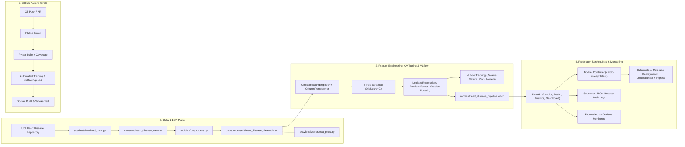

# Cardio-Risk End-to-End MLOps Pipeline
**Course**: Machine Learning Operations (MLOps) — AIMLCZG523 (Assignment 01)  
**Problem Statement**: Predict patient heart disease risk from clinical attributes using the UCI Heart Disease Dataset and deploy the packaged pipeline as a containerized, Kubernetes-orchestrated, and Prometheus-monitored microservice.

---

## 1. Architecture Overview



---

## 2. Repository Structure

```text
MLOPs/
├── .github/workflows/
│   └── mlops_pipeline.yml          # Task 5: GitHub Actions CI/CD workflow
├── configs/
│   └── config.yaml                 # Centralized pipeline & hyperparameter config
├── data/
│   ├── raw/                        # Raw downloaded UCI Cleveland dataset (303 rows, 14 cols)
│   └── processed/                  # Cleaned & imputed dataset with binary target
├── helm/heart-disease-api/         # Task 7: Helm Chart for Kubernetes deployment
├── k8s/                            # Task 7: Kubernetes Deployment, Service & Ingress manifests
├── models/                         # Task 4: Serialized pipeline (.joblib) & model_metadata.json
├── monitoring/                     # Task 8: Prometheus config, Grafana dashboard & Docker Compose
├── notebooks/                      # Deliverable: Reproducible Jupyter notebooks (EDA, Training, Inference)
├── reports/                        # Final 10-page written report (.docx & .pdf), JSON summaries & figures
├── screenshots/                    # Deliverable: Verification screenshots (EDA, MLflow, CI/CD, Docker, K8s)
├── src/
│   ├── data/                       # download_data.py & preprocess.py
│   ├── features/                   # build_features.py (ClinicalFeatureEngineer + ColumnTransformer)
│   ├── models/                     # train.py (CV + MLflow) & predict.py (HeartDiseasePredictor)
│   ├── visualization/              # eda_plots.py & generate_notebooks.py
│   └── api/                        # schemas.py & app.py (FastAPI + Prometheus + Audit Logging)
├── tests/                          # Task 5: Unit & integration tests (pytest)
├── Dockerfile                      # Task 6: Production container definition
├── requirements.txt                # Task 4: Pinned Python dependencies
└── environment.yml                 # Task 4: Conda environment definition
```

---

## 3. Quickstart & Setup Instructions

### 3.1 Clean Environment Setup
```bash
# Option A: Using python venv / uv
python -m venv .venv
# Windows PowerShell:
.\.venv\Scripts\Activate.ps1
# Linux / macOS:
# source .venv/bin/activate

pip install -r requirements.txt

# Option B: Using Conda
conda env create -f environment.yml
conda activate heart-disease-mlops
```

### 3.2 Execute End-to-End Data, EDA & Model Training Pipeline
```bash
# Step 1: Download raw UCI Heart Disease dataset
python -m src.data.download_data

# Step 2: Clean dataset, impute '?' missing values, and generate quality report
python -m src.data.preprocess

# Step 3: Generate Exploratory Data Analysis (EDA) visualizations
python -m src.visualization.eda_plots

# Step 4: Train & tune models (5-Fold Stratified CV), log to MLflow, and package pipeline
python -m src.models.train
```

### 3.3 Launch MLflow Tracking UI (Task 3)
```bash
mlflow ui --backend-store-uri mlruns --port 5000
# Open http://localhost:5000 in browser
```

---

## 4. Automated Testing & Linting (Task 5)

```bash
# Run Flake8 code quality linter
flake8 src/ tests/ --count --statistics

# Run Pytest unit & FastAPI integration test suite with coverage
pytest tests/ -v --cov=src --cov-report=term-missing
```

---

## 5. Local API Serving & Docker Containerization (Task 6)

### 5.1 Run FastAPI Locally
```bash
uvicorn src.api.app:app --host 0.0.0.0 --port 8000
```

### 5.2 Build & Run Production Docker Container
```bash
# Build container image
docker build -t cardio-risk-api:latest .

# Run container on port 8000
docker run -d --name cardio-risk-api -p 8000:8000 cardio-risk-api:latest

# Test /health endpoint
curl http://localhost:8000/health

# Test /predict endpoint with sample patient JSON
curl -X POST http://localhost:8000/predict \
  -H "Content-Type: application/json" \
  -d '{
    "age": 58, "sex": 1, "cp": 4, "trestbps": 140, "chol": 260,
    "fbs": 0, "restecg": 2, "thalach": 135, "exang": 1,
    "oldpeak": 2.2, "slope": 2, "ca": 2, "thal": 7
  }'

# Inspect Prometheus metrics
curl http://localhost:8000/metrics
```
- **Interactive Swagger UI**: `http://localhost:8000/docs`
- **Live Observability & Audit Dashboard**: `http://localhost:8000/dashboard`

---

## 6. Kubernetes Production Deployment (Task 7)

### 6.1 Deploy to Minikube / Local Kubernetes using Manifests
```bash
# Start Minikube cluster and load local Docker image
minikube start
minikube image load cardio-risk-api:latest

# Apply Deployment, LoadBalancer Service, and Ingress manifests
kubectl apply -f k8s/deployment.yaml
kubectl apply -f k8s/service.yaml
kubectl apply -f k8s/ingress.yaml

# Verify pods and services
kubectl get pods,svc,ingress -l app=cardio-risk-api

# Port-forward or expose service to test live Kubernetes endpoint
kubectl port-forward svc/cardio-risk-api-service 8080:80
curl http://localhost:8080/health
```

### 6.2 Alternative Deployment via Helm Chart
```bash
helm upgrade --install cardio-release ./helm/heart-disease-api
```

---

## 7. Monitoring & Logging (Task 8)

- **Structured Request Logging**: Every `/predict` call logs a structured JSON event containing `request_id`, timestamp, patient vitals summary, predicted class, probability, confidence score, risk tier, and inference latency (`logs/api_requests.log` and container stdout).
- **Prometheus Metrics (`/metrics`)**:
  - `heart_api_http_requests_total{method, endpoint, http_status}`
  - `heart_api_request_latency_seconds_bucket{endpoint}`
  - `heart_api_predictions_total{prediction_label, risk_tier}`
  - `heart_api_prediction_confidence_bucket`
  - `heart_api_model_loaded`
- **Full Monitoring Stack (FastAPI + Prometheus + Grafana)**:
```bash
docker compose -f monitoring/docker-compose.monitoring.yml up -d
# FastAPI: http://localhost:8000/dashboard
# Prometheus: http://localhost:9090
# Grafana: http://localhost:3000 (Import monitoring/grafana_dashboard.json)
```
